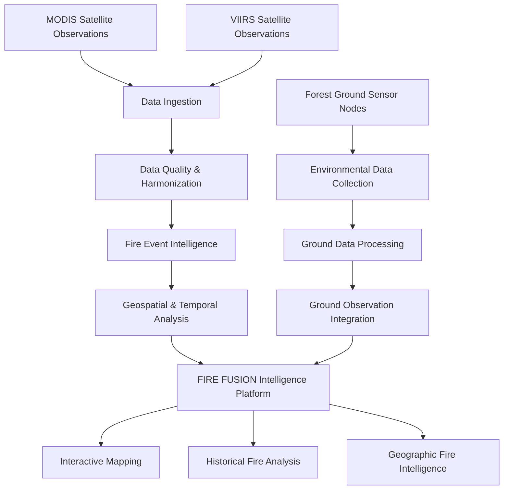

# 🔥 FIRE FUSION
### One Fire. Multiple Satellites. Connected Ground Intelligence.

  <strong>GLOBAL SYNTHETIC SQUAD (G.S.S.)</strong> 
  NASA Space Apps Challenge 2026

---

## 🌍 Overview

**FIRE FUSION** is an integrated satellite-to-ground fire intelligence project developed by **GLOBAL SYNTHETIC SQUAD (G.S.S.)** for the NASA Space Apps Challenge 2026.

The project explores how satellite-based active fire observations, multi-sensor harmonization, geospatial analytics, and forest ground-monitoring technologies can work together to improve the understanding of fire activity.

FIRE FUSION aims to bridge the gap between observations from space and environmental monitoring on the ground through a unified intelligence framework.

## 🔥 The Challenge

Forest fires and uncontrolled burning threaten ecosystems, biodiversity, communities, air quality, and climate.

Satellite systems such as MODIS and VIIRS provide valuable active fire observations. However, differences in sensor characteristics, spatial resolution, and observation timing create challenges when comparing and harmonizing their datasets.

Satellite observations also have limitations in continuously monitoring local environmental conditions at ground level.

FIRE FUSION explores a connected approach to address these challenges.

## 🚀 Our Approach

FIRE FUSION combines two complementary intelligence components.

### 🛰️ Satellite Fire Intelligence

The satellite component focuses on collecting, processing, harmonizing, and analyzing active fire observations.

Research and development objectives include:

- MODIS and VIIRS active fire data harmonization.
- Satellite observation processing and quality assessment.
- Fire observation provenance and metadata management.
- Geographic fire activity visualization.
- Historical and seasonal burning activity analysis.
- Area of Interest (AOI)-based investigation.
- Fire event association and analytical intelligence.
- Exploration of unusual burning activity.

### 🌲 Forest Ground-Monitoring Prototype

The ground component explores an intelligent environmental monitoring node designed for forest deployment.

The proposed prototype investigates:

- Environmental temperature monitoring.
- Thermal anomaly sensing.
- Smoke detection.
- Selected gas and environmental sensing.
- Local environmental data collection.
- Low-power monitoring architecture.
- Wireless communication concepts.
- Integration of ground observations into the FIRE FUSION platform.

The physical prototype and its operational capabilities are subject to hardware implementation, testing, calibration, and validation.

## 🔗 Satellite-to-Ground Workflow

*This diagram represents the proposed integrated project architecture.*

## 🧠 Key Innovation

FIRE FUSION explores the combination of:

- Multi-satellite fire observation harmonization.
- Geospatial fire intelligence.
- Historical burning activity analysis.
- Ground-based environmental monitoring.
- Satellite-to-ground information integration.
- Distributed forest monitoring concepts.

The central vision is to create a more connected understanding of fire activity by combining complementary observations from space and the ground.

## 🛰️ Scientific Data & Research

The project references NASA FIRMS and NASA Earthdata resources for active fire observations and satellite product documentation.

### Primary Research Resources

| Resource | Description |
|---|---|
| NASA FIRMS | Satellite active fire observations |
| MODIS | Terra and Aqua active fire products |
| VIIRS | Suomi-NPP and NOAA satellite active fire products |
| MCD14DL | MODIS Combined Terra and Aqua active fire product |
| MODIS & VIIRS Attributes | Satellite fire data interpretation and metadata |

## 🛠️ Technology & Development

FIRE FUSION explores software and hardware integration through:

- Python-based data processing.
- FastAPI backend development.
- Interactive geospatial visualization.
- Leaflet mapping.
- Satellite data analysis.
- Environmental sensor integration concepts.
- Ground data communication architecture.

## 🔭 Future Development

- Expand MODIS and VIIRS harmonization.
- Improve fire-event association and analytical methods.
- Develop and validate forest monitoring hardware.
- Integrate ground sensor observations.
- Improve sensor calibration and environmental reliability.
- Expand historical fire activity intelligence.
- Investigate scalable satellite-to-ground monitoring systems.

## 👥 Team

### GLOBAL SYNTHETIC SQUAD (G.S.S.)

| Team Member | Responsibility |
|---|---|
| MUHTADI ALAM MAAZ | Team Leader · Frontend Developer · Data Manager |
| MUTASADDIK ALAM MUAZ | Programme Debugger · UI/UX Designer · Researcher |
| SAMSUL ALAM MAHADI | Data Analyzer · Project Manager · Quality Manager |
| ASIF ALVEE | Backend Developer |
| MASHRAFI HASAN BIPLOB | Presenter |
| SUMJARAH KAMEL CHOWDHURY | Video Person |

## 📚 Resources & References

1. 🌲 [Forest Prototype Battery and Satellite Data Harmonization](https://gemini.google.com/notebook/d08159c2-8c47-4869-9af2-44bdf8bcda10)

2. 🛰️ [NASA LANCE FIRMS Active Fire Data](https://firms.modaps.eosdis.nasa.gov/active_fire/)

3. 🔬 [NASA Earthdata MODIS & VIIRS Active Fire Data Attributes](https://www.earthdata.nasa.gov/data/tools/firms/active-fire-data-attributes-modis-viirs)

4. 🌍 [NASA Earthdata MCD14DL Catalog](https://www.earthdata.nasa.gov/data/catalog/lancemodis-mcd14dl-6.1nrt)

## 🏆 NASA Space Apps Challenge 2026

**Project:** FIRE FUSION  
**Team:** GLOBAL SYNTHETIC SQUAD (G.S.S.)  
**Focus:** Satellite Fire Intelligence & Forest Ground Monitoring

## ⚖️ Disclaimer

FIRE FUSION is an independent student-developed project.

Satellite active fire detections represent thermal anomalies detected by satellite instruments and do not necessarily indicate confirmed wildfires.

Proposed ground-monitoring capabilities are conceptual unless explicitly demonstrated through implemented and validated hardware.

FIRE FUSION is not an official NASA product or an operational emergency-response system.

---

  <strong>FIRE FUSION</strong> 
  One Fire. Multiple Satellites. Connected Ground Intelligence.  
  <strong>GLOBAL SYNTHETIC SQUAD (G.S.S.)</strong> 
  🇧🇩 Bangladesh · NASA Space Apps Challenge 2026

